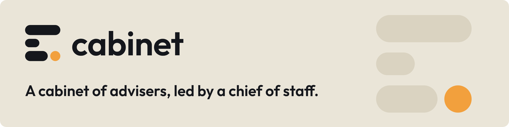

<picture>
  <source media="(prefers-color-scheme: dark)" srcset="https://raw.githubusercontent.com/cabinetlabs/.github/main/profile/banner-dark.png">
  
</picture>

Cabinet is a set of specialist advisers, each good at one thing, led by a chief of staff who knows who to ask and brings back one clear answer.

## The name

In government, a cabinet is the small group of advisers a leader leans on. Cabinet works the same way.

The other cabinet is the one under the desk: a small rack that hums, with a row of status lights. Our mark nods to it, with three pills as rack units and one amber dot, the light that's on.

## Where we are

We're early, and nothing is published here yet. When it is, you'll find it pinned on this page.
